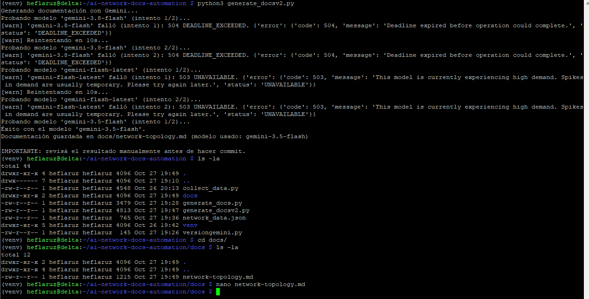

# AI Network Docs Automation

AI Network Docs Automation turns live network telemetry into human-readable documentation. It pulls real data from two sources already running in [network-noc-monitor](https://github.com/HFPRUZ/network-noc-monitor) — Prometheus (via Grafana Cloud) and Tailscale — and uses Gemini to generate a Markdown document describing the current network topology, a Mermaid diagram, and a status summary.

The project is split into two single-purpose scripts: one collects data, the other generates documentation from it. Neither script touches the network directly from inside the AI call — the model only ever sees a JSON snapshot that was collected beforehand.

## How it works

```
collect_data.py          generate_docs.py
┌──────────────┐         ┌──────────────────┐
│ Prometheus    │──┐     │                    │
│ (Grafana Cloud)│  ├──▶│ network_data.json │──▶│ Gemini API │──▶ docs/network-topology.md
│ Tailscale      │──┘     │                    │
│ (tailscale     │         └──────────────────┘
│  status --json)│
└──────────────┘
```

1. **`collect_data.py`** reads the Blackbox Exporter targets from `prometheus.yml`, queries Grafana Cloud's Prometheus endpoint for each target's current `up` status, and reads the local Tailscale client's node list via `tailscale status --json`. It writes everything to `network_data.json`.
2. **`generate_docs.py`** loads that JSON, builds a prompt that explicitly forbids inventing data, sends it to the Gemini API, and writes the result to `docs/network-topology.md`.

## Prerequisites

- The [network-noc-monitor](https://github.com/HFPRUZ/network-noc-monitor) stack already running: Prometheus with a `blackbox_network` scrape job, and a Grafana Cloud Prometheus connection.
- Tailscale installed and connected on the same device that runs these scripts.
- Python 3.11+ and `pip`.
- A free Gemini API key from [aistudio.google.com/apikey](https://aistudio.google.com/apikey).
- A Grafana Cloud access policy token with **`metrics: Read`** scope (separate from the `metrics: Write` token used for `remote_write` in network-noc-monitor — see [Credentials](#credentials) below).

## Setup

```bash
git clone https://github.com/HFPRUZ/ai-network-docs-automation.git
cd ai-network-docs-automation
python3 -m venv venv
source venv/bin/activate
pip install -r requirements.txt
```

### Credentials

Copy the example environment file and fill in your own values:

```bash
cp .env.example .env
```

| Variable | Where to get it |
|---|---|
| `GEMINI_API_KEY` | [aistudio.google.com/apikey](https://aistudio.google.com/apikey) |
| `GRAFANA_PROM_URL` | Your Grafana Cloud Prometheus connection details, **without** the trailing `/push` (e.g. `https://prometheus-xxx.grafana.net/api/prom`) |
| `GRAFANA_INSTANCE_ID` | Same Grafana Cloud Prometheus connection details |
| `GRAFANA_API_TOKEN` | A **new** access policy token scoped to `metrics: Read` only. Do not reuse the `metrics: Write` token from `network-noc-monitor`'s `remote_write` config — keeping read and write credentials separate limits what a leaked token can do |
| `PROMETHEUS_YML_PATH` | Path to the Prometheus config on this device (defaults to `/etc/prometheus/prometheus.yml`) |

This project does not use `.env` loading automatically — export the variables into your shell (e.g. via `~/.bashrc`) before running the scripts, or adapt the scripts to load `.env` with `python-dotenv` if you prefer.

`.env` is excluded from version control via `.gitignore`. Never commit API keys or tokens.

## Usage

```bash
source venv/bin/activate
python3 collect_data.py
python3 generate_docs.py
```

`collect_data.py` prints a short summary of what it found:

```
Datos guardados en network_data.json
  Dispositivos: 6
  Nodos Tailscale: 2
```

`generate_docs.py` prints which model generated the final document and writes the result to `docs/network-topology.md`:

```
Probando modelo 'gemini-3.8-flash' (intento 1/2)...
[warn] 'gemini-3.8-flash' falló (intento 1): 504 DEADLINE_EXCEEDED...
...
Probando modelo 'gemini-3.5-flash' (intento 1/2)...
Éxito con el modelo 'gemini-3.5-flash'.
Documentación guardada en docs/network-topology.md (modelo usado: gemini-3.5-flash)
```

A sample run is shown below:

[](docs/images/ejecucion_generate_docsv2.png)

**Always review the generated file before committing it.** The script header records which model produced it and when, but the content still needs a human check against the source data — see [Responsible AI practices](#responsible-ai-practices) below.

## Prompt design

The prompt sent to Gemini is built in `generate_docs.py`'s `build_prompt()` function. It asks for exactly three Markdown sections (Network Topology, Diagram, Current Status) and includes explicit constraints:

- Use only the data provided — do not invent devices, IPs, or hostnames.
- Label unknown status as `"unknown"` rather than guessing.
- Output valid Markdown only, no extra commentary.

These constraints exist specifically to prevent the model from filling gaps with plausible-sounding but fabricated network details, which would make the generated documentation actively misleading rather than merely incomplete.

## Responsible AI practices

- **No invented data.** The prompt instructs the model to work only from the supplied JSON and to mark unavailable information as unknown rather than inferring it.
- **Traceability.** Every generated file carries an HTML comment header recording the generation timestamp and the specific model that produced it, since the fallback list means different runs may use different models.
- **Human-in-the-loop review.** `generate_docs.py` prints an explicit reminder to review the output before committing it. Generated documentation is treated as a draft, not a final artifact, until a human has checked it against `network_data.json`.
- **Least-privilege credentials.** The Grafana Cloud token used here is scoped to read-only access, separate from the write-scoped token used elsewhere in the stack.

## Model fallback strategy

Gemini's hosted models occasionally return `503 UNAVAILABLE` (high demand) or `504 DEADLINE_EXCEEDED` (timeout) errors. Rather than failing on the first error, `generate_docs.py` retries each model in `MODELS` up to twice with a backoff delay, then moves to the next model in the list:

```python
MODELS = [
    "gemini-3.8-flash",
    "gemini-flash-latest",
    "gemini-3.5-flash",
    "gemini-2.5-flash",
]
```

A fixed model version was chosen over the `-latest` alias as the primary option, so that output is reproducible across runs unless a fallback is triggered — which is itself recorded in the output file's header.

## Project structure

```
.
├── collect_data.py          # Collects live data from Prometheus/Grafana Cloud and Tailscale
├── generate_docs.py          # Sends the collected data to Gemini and writes the generated docs
├── requirements.txt
├── .env.example
├── .gitignore
└── docs/
    ├── network-topology.md   # Example generated output
    └── images/
        └── ejecucion_generate_docsv2.png
```

## Troubleshooting

- **`authentication error: invalid scope requested`** — the Grafana Cloud token being used does not have `metrics: Read`. Create a token from an access policy with that scope (see [Credentials](#credentials)).
- **`Faltan credenciales de Grafana Cloud`** warning from `collect_data.py` — the `GRAFANA_PROM_URL`, `GRAFANA_INSTANCE_ID`, or `GRAFANA_API_TOKEN` environment variables are not set in the current shell. Check with `echo $GRAFANA_PROM_URL` etc., and re-run `source ~/.bashrc` if they were only just added.
- **`404 NOT_FOUND ... is no longer available`** or **`... is not found for API version v1beta`** — the hardcoded model name has been deprecated or renamed. List the models currently available to your API key:
  ```bash
  python3 -c "
  from google import genai
  import os
  client = genai.Client(api_key=os.environ['GEMINI_API_KEY'])
  for m in client.models.list():
      print(m.name)
  "
  ```
  and update `MODELS` in `generate_docs.py` accordingly.
- **`503 UNAVAILABLE` / `504 DEADLINE_EXCEEDED`** — transient Gemini API load or timeout. `generate_docs.py` already retries and falls back across models automatically; if every model in the list fails, wait a few minutes and try again.

## License

See [LICENSE](LICENSE).