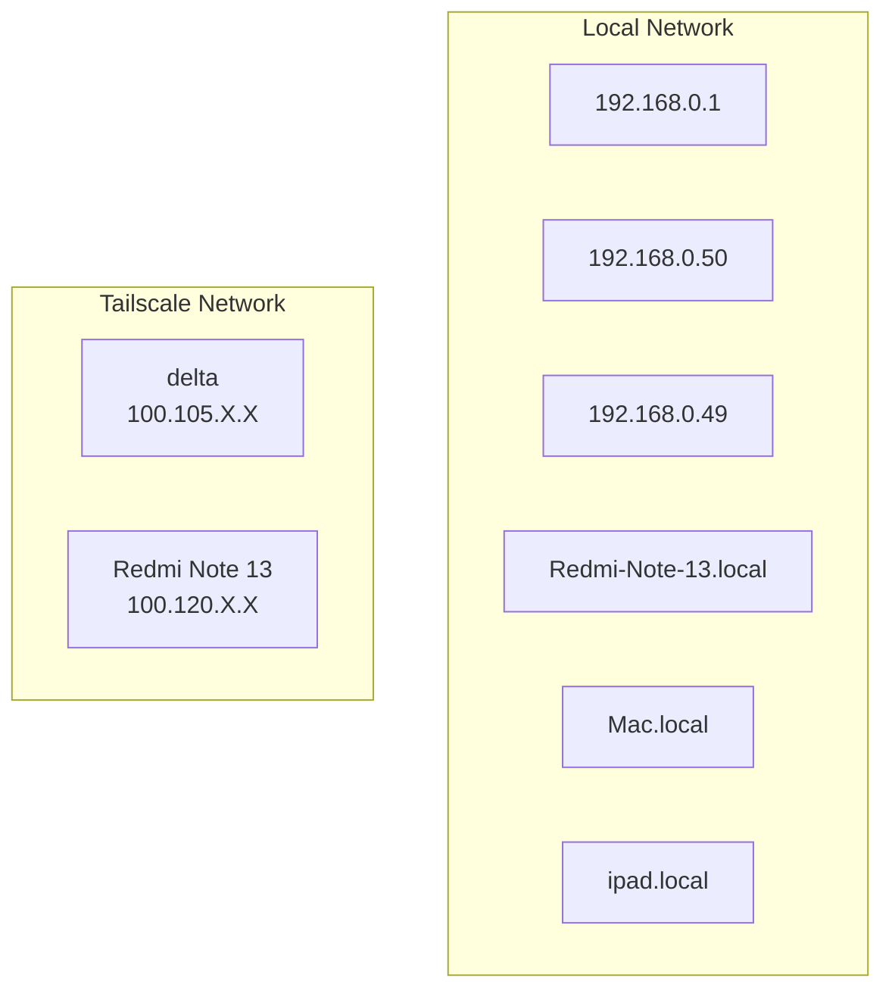

<!-- Auto-generated by generate_docs.py on 2026-10-30T17:20:57.086120+00:00 using model 'gemini-flash-latest'. Review against network_data.json before trusting this content (see README: Responsible AI practices). -->

## Network Topology

The network consists of local LAN devices monitored for reachability alongside Tailscale nodes configured for remote access. The local network includes six monitored targets comprising specific IP addresses (192.168.0.1, 192.168.0.50, and 192.168.0.49) and hostnames (Redmi-Note-13.local, Mac.local, and ipad.local). The Tailscale overlay network contains two nodes: a Linux system named "delta" and an Android device named "Redmi Note 13". Together, these records provide visibility into both direct local connectivity and virtual private network endpoints.

## Diagram

## Current Status
The following devices and nodes are offline or down:
- 192.168.0.49 (status: down)
- Redmi-Note-13.local (status: down)
- Mac.local (status: down)
- ipad.local (status: down)
- Redmi Note 13 (online: false)
